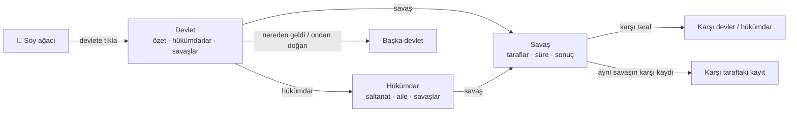

<div align="center">

# 🌳 Türk Devletleri Soy Ağacı

**Asya Hun Devleti'nden bugünkü Türk devletlerine 2.200 yılı tek bir piramit soy ağacında gör; her devlete, hükümdara ve savaşa tıklayarak in.**

Asya Hun → Göktürk → Oğuz → Selçuklu → Osmanlı → Türkiye · ve Kazakistan, Özbekistan, Azerbaycan, Türkmenistan, Kırgızistan, KKTC

[](https://yucel-gumus.github.io/turk-tarih-atlasi/)
[](https://yucelgumus.dev/)


[Canlı demo](https://yucel-gumus.github.io/turk-tarih-atlasi/) · [Özellikler](#-özellikler) · [Nasıl okunur](#-ağaç-nasıl-okunur) · [Kurulum](#-kurulum) · [Veri](#-veri-ve-kaynaklar) · [Mimari](#️-mimari)

</div>

---

## ✨ Özellikler

| | |
|---|---|
| 🌳 **Tek ekran, tek ağaç** | Açılışta yalnızca soy ağacı var. Başka sayfa, menü ya da buton yok |
| 🔺 **Piramit yerleşim** | İlk devlet en tepede ortada, her kuşak kendi satırında, her devlet çocuklarının üstünde ortalı |
| 🪟 **Üst üste modallar** | Devlet → hükümdar → savaş → karşı taraf… her tıklama yeni bir pencere açar; geri tuşu yalnız en üsttekini kapatır |
| ⚔️ **Savaş ayrıntısı** | Kim kime karşı, hangi hükümdar, ne zaman, ne kadar sürdü, sonuç ve ne oldu; karşı tarafın aynı savaş kaydına bağlantı |
| 👑 **Hükümdar kartı** | Saltanat, doğum/ölüm, katkısı ve bedeli, zafer/yenilgi sayımı, eşler, çocuklar (tahta çıkan çocuk kendi kaydına bağlanır) |
| 🖱️ **Fare ve dokunma** | Sürükle, tekerlekle imlece yakınlaş, çift tıkla yakınlaş · telefonda kaydır, kıstır, çift dokun |
| 📚 **Kaynaklı veri** | Her devlet ve hükümdarda en az bir kaynak (çoğunlukla TDV İslâm Ansiklopedisi) |
| 🌗 **Açık / koyu tema** | Sistem temasını izler |

## 📊 Kapsam

| 87 devlet | 748 hükümdar / devlet başkanı | 798 savaş | 190 eş | 763 çocuk |
|:---:|:---:|:---:|:---:|:---:|

## 🧭 Ağaç nasıl okunur

```text
            Asya Hun                ← en tepede ilk devlet
      ┌────────┴────────┐
   Göktürk          Kuzey Hun       ← her satır bir kuşak
      │                 │
     ...               ...
      │
   Osmanlı
      │                             ← düz aşağı: ardıllık (Osmanlı bitti, Türkiye devraldı)
   Türkiye
      └──┐
        KKTC                        ← yana açılan dal: üst devlet yaşarken kuruldu
```

- **Düz aşağı inen çizgi** ardıllıktır: üstteki devlet sona erdi, alttaki onun yerine geçti.
- **Yana açılan dal**, üstteki devlet hâlâ ayaktayken kurulan devlettir (Türkiye → KKTC, Hamîdoğulları → Teke).
- Dalı olmayan çok sayıdaki kardeş (ör. Anadolu beylikleri) yan yana yayılmak yerine **alt alta listelenir**.
- Kırmızı kutular **bugün süren** devletlerdir.

Her bağın türü — *doğrudan devam*, *ayrılan kol* veya *halk ve toprak mirası* (hanedan sürekliliği olmayan ya da tartışmalı bağlar) — ve gerekçesi devlet penceresinde "Soy ağacındaki yeri" bölümünde yazar.

### Modal akışı



## 🚀 Kurulum

Node.js 22.12+ gerekir.

```bash
git clone git@github.com:yucel-gumus/turk-tarih-atlasi.git
cd turk-tarih-atlasi
npm ci
npm run dev        # http://localhost:5173/turk-tarih-atlasi/
```

| Komut | Ne yapar |
|---|---|
| `npm run validate` | Veri şeması, soy ağacı bütünlüğü, tekil kimlikler, tarih sırası, kaynak URL'leri |
| `npm run check` | Svelte + TypeScript tip denetimi |
| `npm test` | Birim testleri (Vitest): ağaç, yerleşim, savaş eşleştirmeleri |
| `npm run test:e2e` | Masaüstü ve mobil tarayıcı testleri (Playwright): modallar, fare, dokunma |
| `npm run verify` | Hepsi + üretim derlemesi |

> [!TIP]
> İlk kullanımda `npx playwright install chromium` çalıştırın; macOS'ta kurulu Google Chrome varsa testler onu kullanır.

<details>
<summary><b>☁️ Yayına alma (GitHub Pages)</b></summary>

Değişiklikleri commit edip `main` dalını push edin, ardından:

```bash
npm run deploy
```

Komut kalite kapısını çalıştırır, temiz kaynak ağacı ister ve derlemeyi `gh-pages` dalına geçmişi koruyarak gönderir. Her yayındaki `release.json` kaynak commit kimliğini taşır. Canlı sürümü doğrulamak için:

```bash
ATLAS_BASE_URL=https://yucel-gumus.github.io/turk-tarih-atlasi/ npm run test:e2e
```

GitHub Actions aynı kalite kapısını her `main` push'unda ve pull request'te çalıştırır.

</details>

## 📚 Veri ve kaynaklar

| Dosya | İçerik |
|---|---|
| `data/raw/*.json` | Devletler, hükümdarlar, savaşlar, eşler, çocuklar (bölge bölge) |
| `data/raw/p-gunumuz.json` | Günümüz Türk devletleri ve devlet başkanları |
| `data/lineage.json` | Soy ağacı: her devletin üst devleti, bağ türü ve gerekçesi |
| `data/SCHEMA.md` | Alanların açıklaması |
| `data/PROVENANCE.md` · `data/FAMILY_AUDIT.md` | Veri kökeni ve aile kayıtları denetimi |

> [!NOTE]
> Savaş, eş ve çocuk kayıtlarının ayrı kaynağı yoktur; pencereleri bağlı hükümdarın kaynaklarını **ilgili kaynaklar** olarak gösterir. Yaklaşık tarihler kesin yıla çevrilmez; savaş süresi yalnız kayıttaki yıl aralığından hesaplanır. "Karşı taraftaki kayıt" aynı adı taşıyan ve yılları örtüşen başka bir devletteki savaştır; tahta çıkan çocuk bağlantısı ad ve dönem eşleşmesidir. Otomatik denetim kaynak okumasının yerini tutmaz.

## 🏗️ Mimari

<details>
<summary><b>📁 Dosya yapısı</b></summary>

```text
src/
  App.svelte                    Soy ağacı + modal yığını + yazar kartı
  components/
    FamilyTree.svelte           Ağaç ekranı: sürükleme, tekerlek/kıstırma, çift tık/dokunma
    ModalStack.svelte           Açık pencerelerin yığını
    Modal.svelte                Pencere kabuğu: geri, iz yolu, tümünü kapat
    views/                      Devlet, hükümdar, savaş ve bağlam içerikleri
    AuthorFooter.svelte         Alttaki yazar kartı
  lib/
    tree/layout.ts              Piramit yerleşimi (kenar çizgisi tabanlı sıkıştırma)
    data/atlas.ts               Veri yükleme, ağaç kurulumu, savaş eşleştirmeleri
    modals.svelte.ts            Modal yığını ↔ tarayıcı geçmişi
  schemas/atlas.schema.ts       Zod veri şeması
scripts/validate.ts             Veri doğrulama
tests/unit · tests/e2e          Vitest ve Playwright testleri
```

</details>

## 📄 Lisans

- Kaynak kodu: [MIT](LICENSE)
- Tarihsel içerik ve veri (`data/`, uygulamada gösterilen metinler): [CC BY 4.0](LICENSE-CONTENT.md)

---

<div align="center">

### 👋 Geliştiren

**Yücel Gümüş** · Full Stack Developer & Yazılım Mühendisi

[](https://yucelgumus.dev/)
[](https://github.com/yucel-gumus)

</div>
